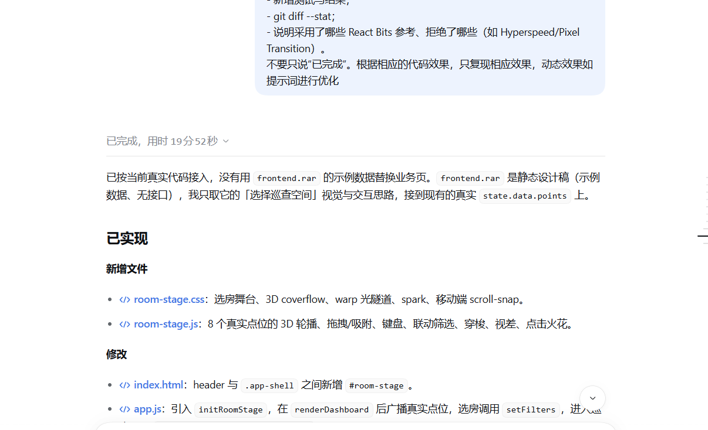

# 对话记录（不完整）

> 本文件不是聊天工具导出的完整会话；只保存本轮可核实的截图和会话原文节选。缺失步骤不补写。

## 1. 用户本轮实际指令（会话原文节选）

```text
重新读取现在前端代码，进行以下修改……
保持当前「日间玻璃工作台」的视觉与业务不变，新增四件事：
1) 首页 3D 旋转木马选房；
2) 选中房间后木马快速定位到该房间，并联动下方列表；
3) 点击「进入巡查」有穿梭（warp）转场；
4) 页面滚动有克制视差，点击有 Spark。
参考 React Bits 的 Circular Carousel / Lightfall / ClickSpark / Circular Gallery，但全部原生重写。
```

完整指令还包括：不引入 React/GSAP/React Bits、不伪造数据、复用 `state.data.points`、保留现有测试、移动端降级等约束。此处只摘录与案例直接相关的部分，未逐字复制全文。

## 2. AI 完成总结截图

用户提供的截图（1206×734），内容为 AI 对本轮实现的完成总结：



原图 SHA-256：

```text
46987ff9f280825638d1a910c13b5b2ffcc49f83728b9a0bf20513c90d513f55
```

## 3. 实际落地的文件

- `frontend/room-stage.js`
- `frontend/room-stage.css`
- `frontend/index.html`（新增 `#room-stage` 与样式引用）
- `frontend/app.js`（import `initRoomStage`，广播 `inspectgo:data`，接入 `setFilters` / `openDetail`）

## 4. 缺失内容

- 没有用户原始提问的界面截图（`01-我的原始提问.png`）。
- 没有 AI 第一版 3D 环方案的截图（`02-AI第一次的方案.png`）。
- 没有单独的用户纠偏指令截图（`04-我的纠偏指令.png`）；实际纠偏来自实现后的浏览器检查，记录在 `03-我发现的问题.md`。

以上缺失不补造；本案例目前只能作为不完整草稿，不能冒充完整 Prompt 链。
