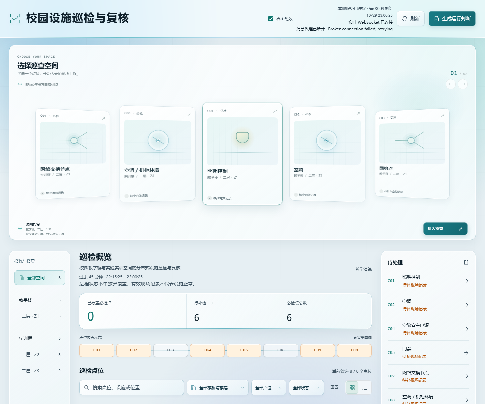

# 3D 选房与穿梭动效

**时间：** 2026-10-30  
**涉及模块：** `frontend/room-stage.js`、`frontend/room-stage.css`、`frontend/index.html`、`frontend/app.js`  
**对应提交：** `cfb8ff4`  
**对应技术文档：** `01_Git提交日志/commit-index.md`、`docs/ai-sessions/2026-10-30.md`

## 一句话结论

证明了我在不引入 React / React Bits / GSAP 的前提下，能把静态设计稿里的选房视觉与交互，落到真实 `state.data.points` 和现有详情/现场记录流程上，并在真实浏览器里用截图、计算样式和点击验证收敛实现，而不是把示例数据直接替换进业务页。

## 过程概要

| 阶段 | 我做了什么 |
| --- | --- |
| 提要求 | 在当前日间玻璃工作台上增加 3D 旋转选房、选中后定位并联动列表、进入巡查的穿梭、滚动视差和点击 Spark；不伪造数据、不改后端。 |
| 检查 | 先确认 `frontend.rar` 是静态示例数据设计稿；读取真实 `frontend/` 代码；用无头 Chrome 在 1440/390 下截图，并读取卡片计算样式、按钮 rect、模拟点击。 |
| 发现问题 | 第一版 3D `preserve-3d` 环在 1440 下侧卡视觉发白、可读性差；390 下「进入巡查」按钮被面板裁切。 |
| 纠偏 | 把满环改成 5 张可见的 3D coverflow（2D 位移 + 轻 rotateY），扩大卡间距到 250px；按钮加显式高对比样式与 footer wrap；保留真实数据和原有详情流程。 |
| 结果 | 页面显示 5 张可读卡片，进入巡查可打开真实详情；单元检查 4/4；按钮与卡片在 1440 下可见。 |

## 我从这件事上学到什么

设计稿里的“看起来对”不等于真实页面里的“可读、可点、可回归”。3D 效果要优先保证信息可读和交互稳定，必要时退回更克制的 coverflow；同时必须用真实数据的 DOM 和测试验证，而不是拿示例数据做静态截图就宣布完成。

## 验证结果

对应检查：8 个真实点位、5 张可见卡、中心卡 C01、右侧「进入巡查」按钮可见；模拟点箭头后列表收敛到 C02，点 C03 后居中，再点 C03 可打开真实详情抽屉。

## 证据缺口（如实说明）

- `01-我的原始提问.png`：本轮没有截到用户原始提问；`对话记录.md` 只摘录了会话原文，未伪造成截图。
- `02-AI第一次的方案.png`：第一版 3D 环的实现过程没有保留截图；`03-我发现的问题.md` 记录了当时的现象与修正。
- `04-我的纠偏指令.png`：纠偏由实现过程中的浏览器检查触发，没有单独保存用户纠偏截图。
- 本案例暂按“草稿”归档；补齐 01/02/04 后才能作为完整比赛案例提交。
