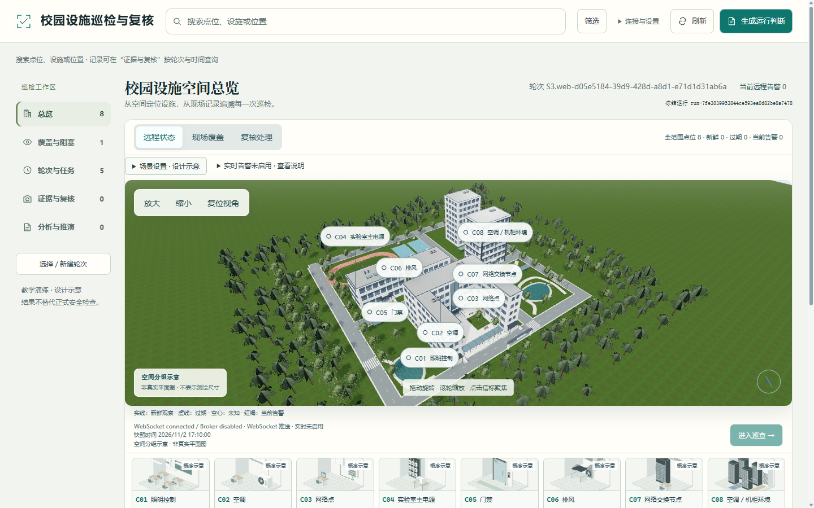

# 校园设施巡检与复核 · 校园分布式设施巡检工作台

> 用现场证据回答“哪里没巡、异常是否复核”。



截图来自隔离教学实例；建筑与室内为设计示意。

## 1. 它解决什么问题

| 项      | 内容                                       |
| ------ | ---------------------------------------- |
| 给谁用    | 校园巡检员、现场复核人员和值班老师                        |
| 在什么场景  | 教学楼与实验实训空间巡检期间，查找缺失记录、补充现场证据、确认异常并复盘     |
| 解决什么   | 把分散设施、当轮现场记录和复核依据连起来，查明哪些必检点未覆盖、哪些异常尚待确认 |
| 明确不做什么 | 不替代专业诊断与真实安全验收，不自动派单、销号或控制真实设备           |

## 2. 核心功能

| 功能            | 当前状态 | 一句话说明                                        |
| ------------- | ---- | -------------------------------------------- |
| 3D 校园与八点位导航   | 已实现  | 校园、封闭建筑、独立设备房间及 C01—C08 导航，进入巡查关联真实详情        |
| 搜索与覆盖缺口       | 已实现  | 搜索编号、名称、位置并组合筛选；覆盖来自六个必检点的当轮有效现场记录           |
| T1—T5 判断与运行历史 | 已实现  | 依赖证据计算任务四态，生成独立 run_id，保留旧运行                 |
| 现场记录、照片与复核    | 已实现  | 保存实际文件与人工结论，支持幂等重试、版本冲突、超时与取消                |
| 待补检提醒与补证消警 | 已实现 | 根据当轮覆盖与已完成 reality 提醒；新复核判断确认缺口消除后移除对应提醒，读取失败或逾期补证不误消警 |
| 实时状态与告警       | 已实现  | MQTT→API→WebSocket；新有效告警弹窗，首次已有告警只入列表        |
| 候选方案与条件推演     | 已实现  | 独立计算方案可行性，what-if 不改现实运行                     |
| T5 分析与巡检助手    | 已实现  | 统计、Web API、RAG、ML、工具及 LLM 串行分析，AI 解释并引用结构化依据 |
| 照片 AI 描述      | 部分实现 | 已接入辅助摘要流程，成功使用需配置支持图像的模型，不能自动形成复核结论          |
| Web 本地语音      | 已实现  | Vosk 转写到可编辑草稿，人工核对后提交                        |
| 微信小程序         | 部分实现 | 原生工程与 HTTP 接入已完成；AppID、平台编译、拍照及语音真机联调待完成     |

设施共 3 区域、8 点位，必检为 C01、C02、C04、C05、C07、C08。巡检轮次采用固定 09:00—09:45 窗口。远程状态不等于现场覆盖，取证失败不等于设施故障，照片上传不等于复核通过；页面、模拟器与 LLM 不直接决定任务状态。

## 3. 10 分钟快速复现

使用 Windows、PowerShell 7 和 Python 3.11。在项目目录打开终端，先执行第 4 节准备环境，再选择下列一条路线。第 4 节会识别当前 `.runtime/twin-worktree` 布局；平铺源码目录也可直接使用。命令使用项目相对路径，不依赖盘符。两条路线使用同一独立演示库，不能同时占用 8017 端口。这是新演示实例，不会恢复本机 8016 的既有记录；恢复已有数据须成套保留原数据库、照片与输入配置。

### 路线 A：完整模式（依赖外部服务）

先按第 5 节在 `.env` 中配置模型地址、名称与凭据；启用模型需将相应开关改为 true。以下命令建立教学 Broker 并加载 `.env`；运行前在第 4 节使用的同一终端执行：

```powershell
$ErrorActionPreference='Stop'
$env:INSPECTGO_PYTHON=(Resolve-Path '.venv\Scripts\python.exe').Path
Remove-Item -LiteralPath 'Env:INSPECTGO_MAINTENANCE_FILE' -ErrorAction SilentlyContinue
if (-not (Test-Path '.runtime\broker-venv\Scripts\python.exe')) {
    & $env:INSPECTGO_PYTHON -B -m venv .runtime\broker-venv
    if ($LASTEXITCODE -ne 0) { throw 'Broker 环境创建失败。' }
}
$env:INSPECTGO_BROKER_PYTHON=(Resolve-Path '.runtime\broker-venv\Scripts\python.exe').Path
& $env:INSPECTGO_BROKER_PYTHON -B -m pip install -r requirements-broker-lock.txt
if ($LASTEXITCODE -ne 0) { throw 'Broker 依赖安装失败。' }
New-Item -ItemType Directory -Path '.runtime\contest-demo\uploads' -Force | Out-Null
if (-not (Test-Path '.runtime\contest-demo\remote-overrides.json')) {
    Set-Content -LiteralPath '.runtime\contest-demo\remote-overrides.json' -Value '{}' -Encoding utf8
}
& $env:INSPECTGO_PYTHON -B -m dotenv -f .env run -- $env:INSPECTGO_PYTHON -B scripts/start_realtime.py --port 8017 --mqtt-port 1884 --db .runtime/contest-demo/isolated.db --uploads .runtime/contest-demo/uploads --overrides .runtime/contest-demo/remote-overrides.json
```

期望结果：终端显示 `Ready: http://127.0.0.1:8017/`。打开 [工作台](http://127.0.0.1:8017/)，可使用 3D、实时教学状态链、巡检、复核、运行和分析功能。模型能力以实际配置为准。首次空库需在“轮次与任务”建立教学实例；Ctrl+C 停止本次服务并保留记录。

### 路线 B：最小可跑模式（无密钥 / 无外网 / 依赖不可用时）

完成第 4 节依赖安装后，本路线无需密钥、Broker 或外部模型。首次安装仍需联网，或另备离线依赖包。

```powershell
$ErrorActionPreference='Stop'
$env:INSPECTGO_PYTHON=(Resolve-Path '.venv\Scripts\python.exe').Path
$env:INSPECTGO_DB=Join-Path (Get-Location).Path '.runtime\contest-demo\isolated.db'
$env:INSPECTGO_UPLOADS=Join-Path (Get-Location).Path '.runtime\contest-demo\uploads'
$env:INSPECTGO_MQTT_ENABLED='false'
$env:INSPECTGO_SEED_DEMO='false'
$env:INSPECTGO_LLM_ENABLED='false'
$env:INSPECTGO_VLM_ENABLED='false'
$env:TEMP=Join-Path (Get-Location).Path '.runtime\tmp'
$env:TMP=$env:TEMP
$env:PYTHONDONTWRITEBYTECODE='1'
Remove-Item -LiteralPath 'Env:INSPECTGO_LLM_ENV_FILE','Env:INSPECTGO_MAINTENANCE_FILE' -ErrorAction SilentlyContinue
New-Item -ItemType Directory -Path $env:TEMP,$env:INSPECTGO_UPLOADS -Force | Out-Null
& $env:INSPECTGO_PYTHON -B -m uvicorn backend.main:app --host 127.0.0.1 --port 8017
```

期望结果：打开 [工作台](http://127.0.0.1:8017/)，看到页面及本地 3D／轻量入口，实时状态明确未启用。在“轮次与任务”建立 S1 并生成判断后，可演示搜索、现场记录、照片、复核、运行历史与条件推演。模型关闭或外部上下文失败时显示受限说明，T1—T4 不因此失败；语音模型缺失时仍可填写文字。

## 4. 环境与依赖

| 软件         | 要求版本                              | 检查命令                        | 我实测的版本             |
| ---------- | --------------------------------- | --------------------------- | ------------------ |
| Python     | 使用 3.11 与项目锁文件；其他大版本未验证           | `py -3.11 --version`        | API／Broker 3.11.17 |
| PowerShell | 7.0 起，实时脚本有版本检查                   | `$PSVersionTable.PSVersion` | 7.6.5              |
| Chrome     | 3D 需要 WebGL2，失败时保留业务入口            | 在浏览器“关于 Chrome”查看           | 156.0.8078.74      |
| Node       | 可选，仅自动检查／资源构建需要全局 fetch、WebSocket | `node --version`            | v24.20.0           |

基础依赖见最新源码的 `requirements-lock.txt`；Broker 依赖为 `requirements-broker-lock.txt`，语音依赖为 `requirements-speech.txt`。前端使用原生 HTML／CSS／JavaScript，本地包含 Three.js、GLB 和贴图，启动无需前端打包或临时 CDN。

在项目目录打开 PowerShell 7，整段复制执行：

```powershell
$ErrorActionPreference='Stop'
if (Test-Path '.runtime\twin-worktree\backend\judgment.py') {
    Set-Location -LiteralPath '.runtime\twin-worktree'
}
if (-not (Test-Path 'backend\judgment.py')) {
    throw '当前目录缺少最新业务源码，请使用包含完整功能的项目源码目录。'
}
New-Item -ItemType Directory -Path '.runtime\tmp','.runtime\pip-cache' -Force | Out-Null
$env:TEMP=Join-Path (Get-Location).Path '.runtime\tmp'
$env:TMP=$env:TEMP
$env:PIP_CACHE_DIR=Join-Path (Get-Location).Path '.runtime\pip-cache'
$env:PIP_DISABLE_PIP_VERSION_CHECK='1'
$env:PYTHONDONTWRITEBYTECODE='1'
if (-not (Test-Path '.venv\Scripts\python.exe')) {
    py -3.11 -m venv .venv
    if ($LASTEXITCODE -ne 0) { throw '需要先安装可由 py -3.11 调用的 Python 3.11。' }
}
$env:INSPECTGO_PYTHON=(Resolve-Path '.venv\Scripts\python.exe').Path
& $env:INSPECTGO_PYTHON -B -m pip install -r requirements-lock.txt
if ($LASTEXITCODE -ne 0) { throw '基础依赖安装失败，请检查下载连接与终端错误。' }
```

本地语音为可选资源，需联网下载并在源码目录运行 `./Setup-Speech.ps1`。默认模型为 Vosk 的 vosk-model-small-cn-0.22；安装脚本校验哈希并保存在项目 `.runtime`。微信需另行取得真实 AppID、合法 HTTPS 后端及语音授权。

## 5. 环境变量

配置样例为当前源码根目录 `.env.example`。继续在完成第 4 节后的同一个终端执行：

```powershell
if (-not (Test-Path '.env')) { Copy-Item -LiteralPath '.env.example' -Destination '.env' }
notepad .env
```

完整模式通过 dotenv 显式加载此文件，填入实际供应商配置后再启动；最小模式忽略它。模型服务凭据不能写进前端、小程序或提交 Git。

| 变量名                                                              | 是否必填      | 作用                      | 不填会怎样                     |
| ---------------------------------------------------------------- | --------- | ----------------------- | ------------------------- |
| INSPECTGO_LLM_ENABLED                                            | 可选        | 启用模型解释，配置完整后设 true      | 默认 false，保留结构化判断与基础统计     |
| INSPECTGO_LLM_BASE_URL                                           | 模型启用时必填   | 模型 HTTPS API 地址         | 模型解释显示配置不完整               |
| INSPECTGO_LLM_MODEL                                              | 模型启用时必填   | 实际模型名称                  | 模型解释显示配置不完整               |
| INSPECTGO_LLM_API_KEY                                            | 模型启用时必填   | 服务端凭据                   | 模型解释不可用，不伪造回答             |
| INSPECTGO_VLM_ENABLED                                            | 可选        | 启用照片辅助摘要                | 默认 false，实际照片保存与人工复核仍可用   |
| INSPECTGO_VLM_BASE_URL／INSPECTGO_VLM_MODEL／INSPECTGO_VLM_API_KEY | 图像模型启用时必填 | 支持图像的供应商、模型和凭据          | 摘要显示未配置或调用失败              |
| INSPECTGO_VLM_REUSE_LLM                                          | 可选        | VLM 三字段全部为空时复用完整 LLM 配置 | 默认 false；部分 VLM 配置不混用共享密钥 |
| INSPECTGO_STALE_SECONDS                                          | 可选        | 远程观察过期阈值                | 默认 10 秒，过期不判故障            |
| INSPECTGO_ASR_MODEL_PATH                                         | 可选        | 指定本地语音模型目录              | 使用项目默认模型；缺失时提示不可用并保留文字操作  |
| INSPECTGO_HTTP_TRUST_ENV                                         | 可选        | 模型 HTTP 使用环境代理          | 默认 false，按后端规则直连          |

运行脚本自动指定本轮解释器、数据目录和 MQTT 连接。路线 B 明确关闭 MQTT／LLM／VLM；不要将模型开关未开启解释成业务任务失败。

## 6. 复现实测记录

**按当前依赖规模与操作步骤填写的时间预算，均为估算、未经本轮真实测试，不作为实测证明。** 估算假定已安装 Python 3.11 与 PowerShell 7、有可用网络及源码访问权限；不包含申请模型账号、微信配置、语音模型下载。最小模式仅指依赖安装后的运行不依赖外网。

| 项    | 内容                                                         |
| ---- | ---------------------------------------------------------- |
| 测试人  | 本轮未实测；由 AI 按工程步骤估算，后续由参赛者核对                                |
| 机器   | 估算参考本机：AMD Ryzen 5 9600X、系统物理内存读取 15.16 GiB、Windows 11 x64 |
| 是否首次 | 按首次安装预算；当前电脑已安装过项目                                         |
| 测试日期 | 未实测；估算编制日期为 2026-11-02                                     |
| 总耗时  | 路线 A 预计 12 分 30 秒；路线 B 预计 8 分 30 秒，均非实测承诺                  |

| 步骤       | 命令／操作                        | 耗时预算（A／B，未实测） | 备注                      |
| -------- | ---------------------------- | ------------- | ----------------------- |
| 1. 拉代码   | 获取最新源码包，在目录打开 PowerShell 7   | 1 分／1 分       | 源码传输受包大小、权限与网络影响        |
| 2. 装依赖   | 第 4 节准备命令；A 另安装 Broker 依赖    | 8 分／5 分       | 可用下载源下的首次安装预算；下载重试会增加耗时 |
| 3. 配环境变量 | 第 5 节复制样例，A 填写已取得的服务配置       | 1 分 30 秒／45 秒 | 不包含申请供应商账号或授权审批         |
| 4. 初始化数据 | 在“轮次与任务”建立教学实例               | 30 秒／30 秒     | 空库自动建表，教学数据由用户显式建立      |
| 5. 启动    | 第 3 节对应启动命令                  | 30 秒／20 秒     | 不含首次下载语音模型              |
| 6. 打开页面  | 浏览器访问 http://127.0.0.1:8017/ | 1 分／55 秒      | 包含首次本地资源加载与简单操作         |

完整模式的估算超过 10 分钟；最小模式未实测，不能据预算宣称满足 10 分钟验收。自动集成检查与首次安装计时分别记录：已安装依赖后的隔离检查由 `scripts/verify_stage08_full.py` 执行，输出在项目 `.runtime/stage08-complete/`，不作为冷机器安装耗时证明。待补检提醒另由 `tests/inspection-alerts-browser.cjs` 验证。这些脚本随代码保存，运行数据库和浏览器产物不提交 Git。

2026-11-02 提交前隔离回归：阶段 08 八组检查通过；其中 Python 86 项与 25 个子用例、前端及小程序单元 105 项通过；待补检提醒另有 7 组浏览器检查通过。本机报告为 `.runtime/stage08-complete/20261102T150049-152241Z/result.json` 与 `.runtime/inspection-alerts-browser/flow-1793631636682/result.json`。检查使用已有依赖、Windows 与 Chrome，关闭付费模型调用；不证明首次安装计时、微信真机或最终人工验收通过。

## 7. 验收清单（跑起来该看到什么）

下列由实际操作者现场勾选；配图为隔离教学数据的既有记录，不冒充本次重新拍摄。阶段 02—07 已获用户验收，阶段 08 的微信平台与最终人工验收尚未完成。

- [ ] 服务启动：完整模式终端显示 Ready 地址；最小模式显示 Uvicorn running 地址。终端验收截图待补充。
- [ ] 打开首页：看到“校园设施巡检与复核”、3D 校园与五个工作区。[总览截图](docs/screenshots/stage08/01-campus-overview.png)。
- [ ] 任务与方案：建立 S3 并生成判断，仅 T1 受阻；甲可执行、乙丙不可执行。[任务](docs/screenshots/stage08/02-s3-tasks.png)／[方案](docs/screenshots/stage08/03-plan-comparison.png)。
- [ ] 现场补证：进入 C07 网络交换房间并打开实际巡查，提交说明与人工结论；出现新证据和新 reality，旧运行保留。[保存截图](docs/screenshots/stage08/04-review-saved.png)。
- [ ] 条件推演：以 S3 为父运行，修改条件创建 what-if，原 reality 不变。[推演截图](docs/screenshots/stage08/05-s4-whatif-a.png)。
- [ ] 异常／降级：建立 S5，C03 unavailable 时 T2 状态未知、T4 待验证；补证后生成新运行，不改旧结果。[原 S5](docs/screenshots/stage08/06-s5-unknown.png)／[补证新运行](docs/screenshots/stage08/07-s5-followup.png)。
- [ ] 告警提示：完整模式的新有效远程告警可弹窗，已有告警只入列表；关闭提示不解除异常。[桌面](docs/screenshots/stage08/08-new-remote-alert.png)／[移动端](docs/screenshots/stage08/09-mobile-alert.png)。
- [ ] 业务提醒：建立 S2 并生成判断，C07 显示“待补检／T1 受阻”；从提醒发起复核并补充窗口内有效现场记录，新判断确认缺口消除后对应提醒移除。仅上传照片、关闭提示、逾期补证或新判断读取失败不消警；旧运行仍保留。
- [ ] 数据留下记录：在“证据与复核”和运行历史中查询本次记录，重启后仍可查看，冷启动检查入口见第 6 节，自动检查不代替最终人工与微信平台验收。

## 8. 排错 FAQ

**Q：笔记本和台式机看到的页面不同。**

- 原因：访问的代码版本、实例或缓存不同；同一个 localhost 地址也可以指向不同电脑。
- 解决：核对完整地址与源码版本，确认使用最新工作树，再刷新浏览器资源。
- AI 协同：用户指出差异后，依据运行地址、分支和实际文件核对版本，没有重置数据来复原截图。

**Q：语音转写提示 network，现场说明没有文字。**

- 原因：原浏览器在线识别链路未完成；此错误不能单独证明麦克风损坏。
- 解决：Web 使用本地 Vosk；安装模型、允许麦克风并通过 HTTPS 或 localhost 打开，失败时保留草稿并使用文字。
- AI 协同：用户选择本地中文识别，AI 接入本机后端；识别结果仍需人工核对，不直接提交证据。

**Q：复制 .env 后配置没有生效。**

- 原因：原启动器不会自动加载 .env。
- 解决：完整模式使用 `python -m dotenv -f .env run` 显式加载，填好配置后重启本次服务；最小模式明确使用关闭增强的进程环境。
- AI 协同：读取实际配置代码后修正文档，避免只复制文件却没有加载步骤。

**Q：选了其他教学场景，为什么还看到旧的 T1 阻塞和乙丙不可执行？**

- 原因：场景下拉框选择的是下一次要建立的实例，已有轮次和冻结运行不会自动改变；甲乙丙是方案名称，不是三名人员。
- 解决：先点击“建立对应教学实例”，再生成判断。本版本显示当前轮次与待建立场景，并阻止场景不一致时误生成旧轮次。S3 中乙需 P2 可用且具备 Z3 权限；丙需足够时间与授权协同。仅比较假设时用“条件推演”，可执行不表示补检已完成。
- AI 协同：先只读核对实际 S1／S2／S3 运行，再修正界面歧义；保留案例原定任务与方案计算规则，用隔离浏览器验证 S5 和条件推演。

**Q：T1 已受阻，为什么“当前远程告警”仍为 0？**

- 原因：待补检／任务受阻与设备远程告警是不同语义；前者不表示设施故障。
- 解决：查看“巡检提醒”及其轮次、依据 run_id。复核后的新判断确认缺口消除才移除对应提醒；旧运行不会被覆盖，逾期记录不能补算固定窗口。
- AI 协同：用户指出缺少业务弹窗后，AI 增加独立提醒投影，并用正常补证、逾期补证、读取失败和切换轮次测试约束消警。

## 9. AI 协同说明

| 项     | 内容                                                   |
| ----- | ---------------------------------------------------- |
| 使用的工具 | Codex；历史案例中另有 WorkBuddy 与 DeepSeek 的使用记录             |
| 怎么用的  | 用户拆解业务与视觉要求，AI 阅读代码、提出方案、实现和定位问题，用户纠偏并验收阶段结果         |
| 对话记录  | 已保存日常截图见 `docs/ai-sessions/`；本机竞赛案例为 Web 动效、3D 建模、待补检告警与现场补证消警三项，桌面案例本次不随 README 导入。                        |
| 人工把关  | 覆盖、设备状态与复核分开；禁止 LLM 直接判定状态；不伪造照片、告警与结论；视觉示意和真实证据分别标明 |

## 10. 目录结构

当前最新源码在 `.runtime/twin-worktree`，环境准备命令会进入该目录；整理为平铺源码包后从其根目录执行即可。当前源码结构如下：

```text
项目源码/
├── backend/                 # API、存储、证据、判断与复核
├── frontend/                # 工作台与 Three.js
│   ├── twin/                # 场景、镜头与交互
│   ├── assets/              # 模型、贴图与来源
│   └── vendor/              # 本地第三方运行库
├── config/                  # 设施、任务、方案、S1—S5
├── simulators/              # 教学数据与 Broker
├── miniapp/                 # 原生微信小程序
├── scripts/                 # 启动、安装与配置
├── tests/                   # 规则、接口与交互检查
├── docs/                    # 文档与对话证据
├── .env.example             # 配置样例
└── requirements-lock.txt    # 基础依赖锁文件
```

## 11. 已知限制

| 限制                   | 影响                            | 后续打算                   |
| -------------------- | ----------------------------- | ---------------------- |
| 最新功能在 feat/campus-twin 分支 | 默认 main 与云端不保证包含本版功能；本次只做本地提交 | 交付前明确集成目标并固定提交版本 |
| 时间为估算，未做本轮首次安装计时     | 不能作为 10 分钟复现实测证明              | 正式交稿前由参赛者按实际机器核对与替换    |
| 微信工程尚未完成平台与真机联调      | Camera、上传及 ASR／TTS 的平台效果待确认   | 取得 AppID、权限和可访问后端后验收   |
| 远程数据来自教学模拟器，校园为设计示意  | 不能当真实设备监测、实景测绘或专业安全判断         | 保留明确标注，真实接入另行取证        |
| 模型服务与本地语音受配置、网络和噪声影响 | AI 增强可受限，编号、方言可能误识别           | 可信降级、保留文字与人工核对         |
| 尚无多人身份认证，浏览器／设备覆盖有限  | 不适合直接公开为真实生产服务，未证明全部手机性能      | 补充访问控制和目标设备验收          |
| 部分截图和首次复现证据缺失        | 当前材料仍不是最终竞赛验收包                | 补充终端、干净机器、S1／S2及微信真机证据 |
