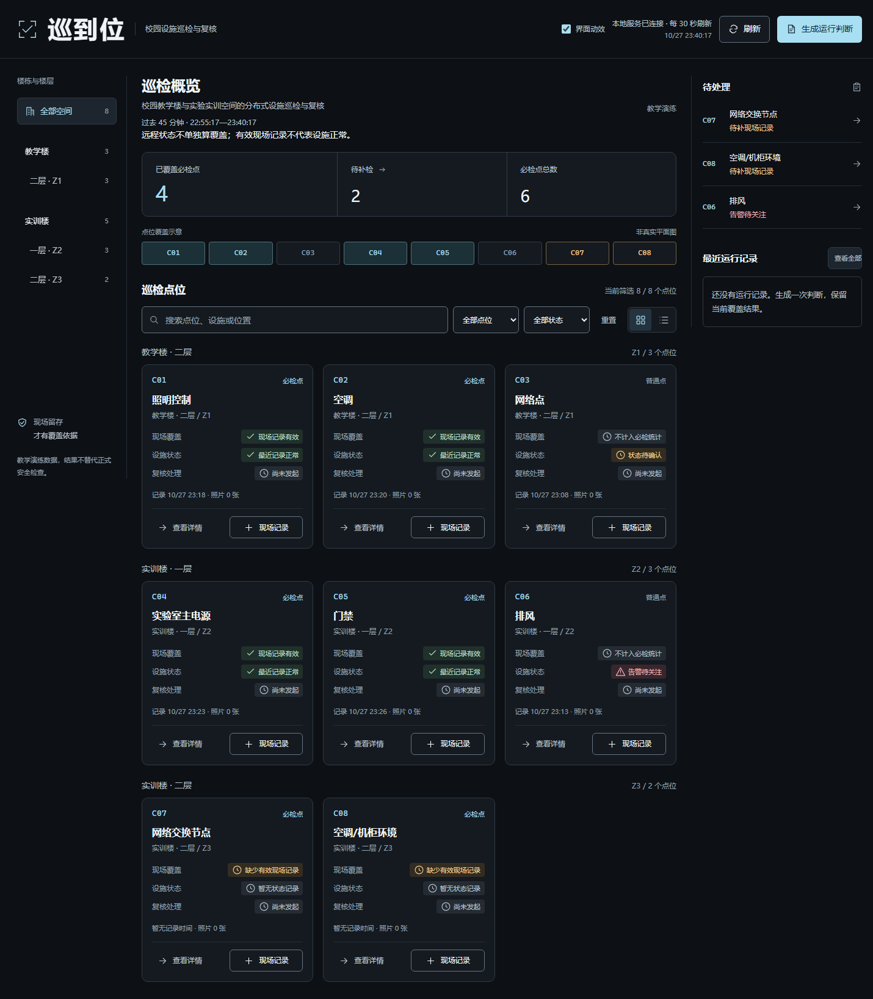
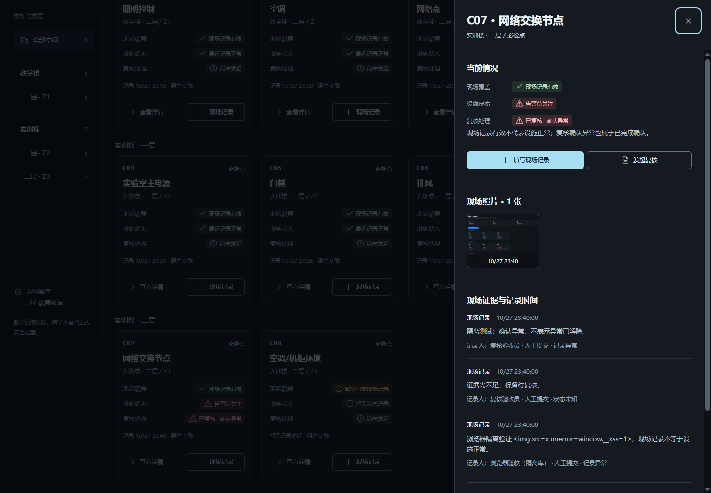
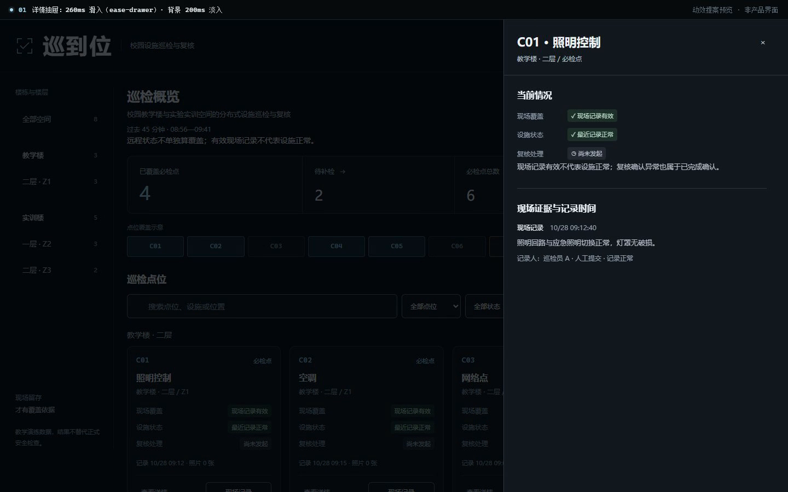
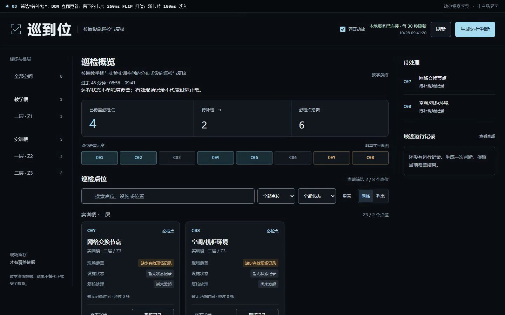

# 巡到位 InspectGo · 前端界面与动效检验报告

> 审查日期：2026-10-28 ｜ 方式：只读审查 ｜ 结论：**未修改任何源码、文案、数据库或照片**。
>
> 依据：`frontend/` 全部源码、2026-10-27 的浏览器验收截图、你提供的两段参考录屏，以及一份独立的动效提案预览（`preview.html` + `motion-preview.mp4`）。

---

## 0. 一句话结论

界面的底子（暗色控制台、信息层级、键盘可达性、动效开关）是好的，不需要重做视觉；真正拖后腿的是**动效只做了"装饰层"，没做"反馈层和空间层"**——详情抽屉瞬开、保存提示被抽屉盖住且硬切、按钮没有按压反馈。建议只做 P1（反馈）+ P2（空间）两组小改动，4 个文件内的 CSS/JS，不改业务与文案；网格／列表重排、数字滚动、营销站式 hero 动效**不建议**做。

**最高杠杆的三件事：**

1. 把 toast 移入 top layer（popover），并补 180ms 进出场——现在保存成功的提示在抽屉打开时根本看不见。
2. 详情抽屉 260ms 从右侧滑入、背景 200ms 淡入——这是全页最高频的大面积状态变化。
3. 按钮补 120ms 的 `scale(0.97)` 按压反馈——刷新、生成判断、筛选、保存都受益。

---

## 1. 检验范围与证据

| 项目 | 内容 |
| --- | --- |
| 页面 | 单页工作台（`frontend/index.html`），含概览、点位网格／列表、右侧待处理与运行记录、详情抽屉、照片预览、运行判断弹窗 |
| 样式 | `frontend/styles.css` 396 行；`frontend/motion.css` 90 行 |
| 脚本 | `frontend/app.js` 203 行；`frontend/motion.js` 245 行；`frontend/model.js` |
| 既有截图 | `.runtime/ui-check/desktop-1440.png`、`detail-review.png`、`title-flip.png`（2026-10-27 23:40 的浏览器验收产物） |
| 参考录屏 | 两段，共 13.1s：内容是 Landfall／Metrica 两个营销站、NOTHIN' 作品集，以及 GitHub 上的 `design-to-motion`、`gsap-skills` 仓库；**不是本项目的运行录像** |
| 未覆盖 | 真实数据库写入、真机／移动设备录制、跨浏览器实测；相关结论在文中标注"需真机确认" |

> 说明：你给的两段录屏是"参考审美 + 技能来源"，不是产品现状。营销站的 hero 动效（整屏视差、滚动叙事、大字入场）不适合直接搬进巡检工作台；可借用的是**节奏、层级和缓动纪律**，不是效果本身。详见第 8 节。

---

## 2. 现状盘点

### 2.1 已有的动效

| # | 元素 | 触发 | 实现 | 参数 | 评价 |
| --- | --- | --- | --- | --- | --- |
| M1 | 品牌标题 3D 翻转 | 首次进入 / 悬停标题 | `motion.css:34-50` + `motion.js:59-64` | 800ms，`cubic-bezier(0.16,1,0.3,1)`，三字 0/80/160ms 延迟 | 稀有装饰，克制；1s 冷却合理 |
| M2 | 鼠标短拖尾 | 桌面精确指针移动 | `motion.js:94-161`，Canvas2D + rAF | 空闲 250ms 停止；DPR 上限 1.5；轨迹 24 点 / 115px | 性能可控；在弹层、按下、选中、滚动时都会停，考虑周全 |
| M3 | 按钮悬停 | hover | `styles.css:58` | 150ms `ease`，仅颜色 | 只有颜色，没有按压 |
| M4 | 点位卡片悬停 | hover | `styles.css:139-140` | 150ms `ease`，仅边框色 | 轻微，合适 |
| M5 | Toast | 保存／刷新／失败 | `app.js:43-44` + `styles.css:390-391` | 无过渡；6.5s 后直接消失 | **硬切，且被弹层遮住**（见 F1） |
| M6 | 详情抽屉 | 查看详情／现场记录／处理复核 | `app.js:106` + `styles.css:193-194` | 无 | **瞬开**（见 F2） |
| M7 | 照片预览／运行判断 | 打开对应弹窗 | `styles.css:232-242` | 无 | 瞬开 |
| M8 | 筛选／视图切换 | 搜索、下拉、快捷筛选、网格↔列表 | `app.js:65-76`、`app.js:185` | 无 | DOM 同步重排，卡片瞬移 |
| M9 | 骨架屏 | 首次加载 | `styles.css:184-189` | 静态色块 | 无呼吸／微光 |
| M10 | 减少动态效果 | 系统设置 | `styles.css:363-366`、`motion.css:74-84` | 全局 `transition-duration: 0s`；隐藏标题翻转与拖尾 | 方向对，但只覆盖 transition，不覆盖 animation |
| M11 | 动效开关 | 顶栏复选框 | `motion.js:163-173` + `localStorage` | `data-motion=on/off` | 语义目前只覆盖装饰，方案中必须明确边界 |

### 2.2 已经做对、不要改坏的部分

- 焦点管理：`app.js:194-203` 的 Tab 陷阱、Escape 关闭、关闭后焦点回到触发元素（`app.js:186`）。
- `body:has(dialog[open]) { overflow: hidden }`（`styles.css:393`）避免背景滚动。
- `prefers-reduced-motion` 下标题与拖尾都被正确关闭（`motion.css:74-84`）。
- 拖尾的克制条件：弹层打开、按下、选中文本、滚动、页面隐藏、触屏/粗指针时都停止（`motion.js:46-50`、`97-99`、`211-214`）。
- 没有 `transition: all`；`will-change` 只在标题翻转期间出现（`motion.css:34-37`）。
- `aria-live`、`role="status"`、skip link、`aria-busy` 等无障碍细节齐全。

---

## 3. 问题清单（按杠杆排序）

| # | 严重度 | 类别 | 位置 | 现象与证据 | 影响 | 建议 |
| --- | --- | --- | --- | --- | --- | --- |
| F1 | **HIGH** | 层级 / 反馈 | `styles.css:247`、`393`；`app.js:44`、`106` | `#detail-dialog` 用 `showModal()` 进入 top layer；`.toast` 只有 `z-index: 90`。抽屉打开时 toast 被面板整块盖住（移动端抽屉全屏时完全不可见）。演示页第一版复现：文案已写入，截图里看不到。 | 保存现场记录、发起复核、刷新后的成功/失败提示在最需要时不可见；用户只能靠内容变化猜测结果。 | toast 改为 `popover="manual"`，用 `showPopover()` 进入 top layer；补 180ms 进出场。 |
| F2 | **HIGH** | 空间 / 打断 | `styles.css:193-194`；`app.js:106` | `showDialog()` 直接 `showModal()`，抽屉与背景都没有过渡。 | 全页最高频的大面积变化（每次看详情／记录／复核）都是硬切，用户失去"从右侧进入"的空间连续性。 | 260ms 滑入 + 200ms 背景淡入；关闭用 CSS `allow-discrete`，不改 `open` 的同步时序。 |
| F3 | MEDIUM | 反馈 | `styles.css:58` | `.btn` 只过渡 `background-color/border-color/color`，全仓没有 `:active` 规则。 | 刷新、生成判断、视图切换、保存等按钮点击瞬间缺少物理确认；触屏上尤其空。 | `:active { transform: scale(0.97) }`，120ms `ease-out`。 |
| F4 | MEDIUM | 反馈 | `styles.css:390-392` | 有 `visibility/opacity` 终态，但没有 `transition`；6.5s 后直接切走。 | 提示出现和消失都是"闪一下"，与界面其他 150ms 过渡不在一个语汇里。 | 与 F1 同批修：180ms 淡入 + 上移 12px，退出同路径。 |
| F5 | MEDIUM | 状态连续性 | `app.js:65-76`、`185` | `renderFacilities()` 同步重建／移动卡片，筛选、重置、待补检、视图切换都瞬移。 | 用户筛选后要重新定位；但搜索是逐字触发，**绝不能**逐字动画。 | 只在"显式筛选/快捷筛选"做一次性 FLIP；输入搜索时禁用。 |
| F6 | MEDIUM | 结构 | `app.js:63`、`87`、`90` | `card.update` 每次都用 `statuses.replaceChildren(...)` 重建徽标节点；30s 自动刷新也会重建。覆盖节点 `.map-point` 是复用节点（`app.js:90`），所以只有它能直接过渡。 | 任何给状态徽标加的 CSS 过渡都不会生效；保存后状态变化仍是硬切。 | 方案 A：只给覆盖节点加过渡 + 一次性光晕；方案 B：把 `card.update` 改为就地更新（可选）。 |
| F7 | LOW | 一致性 | `styles.css:1-22`、`58`、`139` | 没有动效令牌；150ms `ease` 与 800ms 贝塞尔散落。 | 新增动画容易各写各的，语汇不统一。 | 加 `--ease-out` / `--ease-in-out` / `--ease-drawer` / `--dur-*` 并替换现有 `ease`。 |
| F8 | LOW | 加载 | `styles.css:184-189` | 骨架屏是静态色块。 | 首次加载略"死"，但出现时间短，收益有限。 | 可选：1.6s 呼吸；reduced-motion 下静态。 |
| F9 | **约束** | 无障碍 | `styles.css:363-366` | 全局只把 `transition-duration` 归零，`animation` 不受影响。 | 新增的 CSS animation（如光晕）在减少动态效果下仍会播放。 | 每个新 animation 都要在 reduced-motion 里显式 `animation: none`，或改成 opacity 过渡。 |
| F10 | INFO | 已做对 | — | 焦点陷阱、滚动锁、拖尾的停止条件、动效开关持久化都正确。 | — | 保持，不要为动效破坏这些约束。 |

### 3.1 关键证据（可直接复核）

- `frontend/app.js:106`：`function showDialog(dialog){if(!dialog.open)dialog.showModal();overlayChanged();}` —— 没有任何动画钩子。
- `frontend/styles.css:193-194`：`.drawer{position:fixed;...}`、`.drawer[open]{display:flex}` —— 打开即显示。
- `frontend/styles.css:390-391`：`.toast{visibility:hidden;opacity:0}`、`.toast.visible{visibility:visible;opacity:1}` —— 只改终态，没有 `transition`。
- `frontend/app.js:44`：`toast()` 只切 class，6.5s 后移除 class。
- `frontend/app.js:63`：`statuses.replaceChildren(statusRow(...),...)` —— 每次刷新都会替换徽标节点。
- `frontend/app.js:184`：`$('search').addEventListener('input', e=>setFilters({query:e.target.value}))` —— 每个按键都会重排，必须排除在动画之外。

---

## 4. 被否决的候选（为什么不做）

| 候选 | 否决理由（对应四问） |
| --- | --- |
| 概览数字 `4 / 2 / 6` 做 count-up 滚动 | **功能**：这是用户要读取的判断数字，不是装饰；且每 30s 自动刷新会反复滚动。**频率**：高频。 |
| 8 张卡片逐张入场／级联 | **频率**：工作台每天多次进入；**功能**：延迟内容出现，30s 刷新还会重放。收益低于成本。 |
| 搜索输入逐字做 FLIP／淡入 | **频率**：键盘高频（100+/天）；动画会让输入显得迟滞。只在显式筛选时做一次性过渡。 |
| 网格↔列表切换用 View Transitions | 技术上可行，但 `startViewTransition` 的回调是异步的，会改变 DOM 更新时机；`tests/browser.cjs:30` 在点击后立即断言 `list-view`，会失败。需要同时改测试，列为"单独授权"项。 |
| 引入 GSAP 或 React Bits 运行时 | 现有微交互用 CSS/WAAPI 足够；GSAP 约 70KB，对 8 张卡片不划算；React Bits 是 React 组件，本项目是原生 JS。 |
| 大面积 WebGL／粒子背景、滚动视差 | 与"巡检工作台"的气质不符，主线程、电量、低端机成本都高；现有 Canvas2D 拖尾已是上限。 |
| 弹窗退出用 `setTimeout` 延迟 `close()` | 会改变 `dialog.open` 的时序，破坏 `tests/browser.cjs:41`（Escape 后立即断言照片弹窗 `open` 为 false）与焦点返回。改用 CSS 离散过渡，`open` 仍然立即移除。 |
| Toast 放到抽屉 DOM 里 | 可行但耦合：每个 dialog 都要复制一份；popover 是更干净的解。 |

---

## 5. 优化方案

### 5.1 三条设计原则

1. **只在三种时刻动**：反馈（按下、保存）、空间（抽屉、弹窗）、状态（覆盖节点、徽标）。装饰只保留标题翻转与拖尾。
2. **动效预算 120–260ms**；绝不为动画延迟 DOM 更新——测试、键盘操作、屏幕阅读器都依赖同步状态。
3. **只动合成层**：`transform` / `translate` / `scale` / `opacity`；颜色过渡仅限背景、边框、文字色。禁止 `transition: all`，禁止动画 `width/height/top/left/margin`。

### 5.2 动效令牌（P0，无视觉变化）

加到 `frontend/styles.css` 的 `:root`（第 1–22 行区块）：

```css
--ease-out: cubic-bezier(0.23, 1, 0.32, 1);
--ease-in-out: cubic-bezier(0.77, 0, 0.175, 1);
--ease-drawer: cubic-bezier(0.32, 0.72, 0, 1);
--dur-press: 120ms;
--dur-ui: 180ms;
--dur-panel: 260ms;
```

把 `.btn`（58 行）与 `.point-card`（139 行）里的 `ease` 换成 `var(--ease-out)`；这一步不改任何时长与观感。

### 5.3 P1 反馈层（先做，风险最低）

**P1-a 按钮按压**

```css
.btn {
  transition: background-color 150ms var(--ease-out),
              border-color 150ms var(--ease-out),
              color 150ms var(--ease-out),
              transform var(--dur-press) var(--ease-out);
}
.btn:active { transform: scale(0.97); }
@media (prefers-reduced-motion: reduce) { .btn:active { transform: none; } }
```

按压只作用于按钮自身，不影响布局；`:active` 在键盘 Enter 上也会出现，属于可接受的 120ms 反馈。

**P1-b Toast 层级 + 进出场（同时修 F1/F4）**

- `frontend/index.html:103` 的 toast 元素加 `popover="manual"`，保留 id、class、`role="status"`、`aria-live="polite"`。
- `showPopover()` 后元素进入 top layer，天然位于已打开的抽屉之上；不再依赖 `z-index`。
- 进出场：`translate: 0 12px` → `0 0`，180ms；退出同路径；`visibility` 只在隐藏时延迟 180ms。

```css
.toast {
  position: fixed; inset: auto 24px 24px auto; margin: 0;
  visibility: hidden; opacity: 0; translate: 0 12px;
  transition: opacity var(--dur-ui) var(--ease-out),
              translate var(--dur-ui) var(--ease-out),
              visibility 0s linear var(--dur-ui);
}
.toast.visible {
  visibility: visible; opacity: 1; translate: 0 0;
  transition: opacity var(--dur-ui) var(--ease-out),
              translate var(--dur-ui) var(--ease-out),
              visibility 0s;
}
```

```js
function toast(message, isError = false) {
  const t = $('toast');
  t.textContent = message;
  t.classList.toggle('is-error', isError);
  if (t.showPopover) {
    if (t.matches(':popover-open')) t.hidePopover();
    t.showPopover();
  }
  requestAnimationFrame(() => t.classList.add('visible'));
  clearTimeout(toastTimer);
  toastTimer = setTimeout(() => {
    t.classList.remove('visible');
    if (t.showPopover) setTimeout(() => t.matches(':popover-open') && t.hidePopover(), 200);
  }, 6500);
}
```

注意：popover 默认 `inset: 0; margin: auto`，必须用 `inset: auto 24px 24px auto; margin: 0` 复位；`pointer-events: none` 保持。

**P1-c 覆盖节点状态过渡**

`styles.css:103` 的 `.map-point` 加：

```css
transition: background-color 200ms var(--ease-out),
            border-color 200ms var(--ease-out),
            color 200ms var(--ease-out);
```

保存成功、`renderDashboard()` 把 `is-missing` 改成 `is-covered` 时，颜色会过渡。若想要一次性"确认感"，用伪元素做 600ms 外扩光圈（避免 `box-shadow` 逐帧重绘）：

```css
.map-point { position: relative; }
.map-point.is-changed::after {
  content: ""; position: absolute; inset: 0; border-radius: 4px;
  border: 1px solid var(--accent); opacity: 0;
  animation: node-confirm 600ms var(--ease-out);
}
@keyframes node-confirm {
  0% { opacity: 0.55; scale: 1; }
  100% { opacity: 0; scale: 1.18; }
}
@media (prefers-reduced-motion: reduce) { .map-point.is-changed::after { animation: none; } }
```

**P1-d（可选）状态徽标就地更新**

现状 `card.update` 每次 `replaceChildren`，徽标节点被替换，CSS 过渡永远跑不起来。若希望"最近记录正常 → 告警待关注"这类变化有 200ms 颜色过渡，需要把 `card.update` 改成复用三个 `.status-badge` 节点、只改 `className` 与 `textContent`。这是结构改动，建议单独一批做，并先跑浏览器回归。

### 5.4 P2 空间层

**P2-a 详情抽屉（260ms）**

```css
.drawer {
  translate: 100% 0;
  transition: translate var(--dur-panel) var(--ease-drawer);
}
.drawer[open] { translate: 0 0; }
@starting-style { .drawer[open] { translate: 100% 0; } }

@supports (transition-behavior: allow-discrete) {
  .drawer {
    transition: translate var(--dur-panel) var(--ease-drawer),
                display var(--dur-panel) allow-discrete,
                overlay var(--dur-panel) allow-discrete;
  }
  .drawer::backdrop {
    opacity: 0;
    transition: opacity 200ms var(--ease-out),
                display 200ms allow-discrete,
                overlay 200ms allow-discrete;
  }
  .drawer[open]::backdrop { opacity: 1; }
  @starting-style { .drawer[open]::backdrop { opacity: 0; } }
}

.drawer:not([open]) { pointer-events: none; }
#detail-dialog[open] .drawer-body > * {
  animation: drawer-content-in 220ms var(--ease-out) both;
}
#detail-dialog[open] .drawer-body > *:nth-child(2) { animation-delay: 60ms; }
@keyframes drawer-content-in {
  from { opacity: 0; translate: 0 8px; }
  to { opacity: 1; translate: 0 0; }
}
```

关键点：

- **不要**用 `setTimeout` 延迟 `close()`。`dialog.open` 仍然在点击/ Escape 的同一帧变为 false，退出只是视觉上多留 260ms（`display`/`overlay` 的离散过渡）。
- 不支持 `allow-discrete` 的浏览器：入场仍有动画（`@starting-style`），退场直接消失，属于可接受的降级。
- 移动端抽屉是全屏，`translate: 100%` 同样成立。

**P2-b 照片预览 / 运行判断（180ms）**

```css
.photo-dialog, .run-dialog {
  opacity: 0; scale: 0.96;
  transition: opacity var(--dur-ui) var(--ease-out),
              scale var(--dur-ui) var(--ease-out);
}
.photo-dialog[open], .run-dialog[open] { opacity: 1; scale: 1; }
@starting-style {
  .photo-dialog[open], .run-dialog[open] { opacity: 0; scale: 0.96; }
}
```

居中弹窗不适用"从触发元素长出"的 origin 规则，保持 `center` 即可。

**P2-c 抽屉内切换点位／模式（可选）**

`openDetail()` 在抽屉已打开时替换内容（C07 → C08、当前情况 → 表单），目前是硬换。可给 `#detail-body` 加 120ms 交叉淡入（`opacity` 从 0.6 → 1，不做位移），成本极低。

### 5.5 P3 重排层（可选，必须保持 DOM 同步）

**只对显式筛选做**：`#missing-shortcut`、`#required-filter`、`#status-filter`、`#mobile-scope`、`#reset-filters`、左侧范围导航。搜索输入、30s 自动刷新、初次加载都不做。

算法（FLIP，transform-only）：

1. 过滤前记录每张 `.point-card` 的 `getBoundingClientRect()`。
2. **同步**调用 `renderFacilities()`（测试与可访问性依赖同步）。
3. 下一帧：留下的卡片用 `element.animate([{ transform: 'translate(dx, dy)' }, { transform: 'none' }], { duration: 260, easing: 'cubic-bezier(0.23,1,0.32,1)' })` 归位；新出现的卡片加 `.is-entering`（180ms 淡入 + 6px 上移）。
4. `prefers-reduced-motion` 或卡片数 > 12 时跳过。

不要做"先让旧卡片退场 120ms 再更新 DOM"——那会让 `tests/browser.cjs:30` 的立即断言失败。

### 5.6 P4 细节（可选）

- 骨架屏 `background-position` 或 opacity 呼吸 1.6s；只在首次加载出现，reduced-motion 下静态。
- 保存成功的顺序：内容更新 → 120ms 后 toast；让"结果"先于"提示"，建立因果感。
- 标题翻转保持现状；它是全页唯一的"签名动作"，不要再加第二个。

### 5.7 视觉层判断

不需要换色、换字体、重做栅格。当前暗色控制台的层级（标题 → 概览 → 点位 → 右栏）清晰，问题不在"好不好看"，而在"变化有没有被解释"。做完 P1+P2，页面观感会有明显提升；再动视觉反而会稀释它。

---

## 6. 可直接复制的提示词（Prompt Pack）

> 用法：一次只贴一条；每条都假设执行模型**没有**本对话的上下文。P1、P2 可分别独立执行，P3/P4 需要单独授权。

### 6.0 总控提示词（每次先贴）

```text
你在 D:\校园设施巡检与复核 这个仓库工作。项目是原生 HTML/CSS/JS（无前端构建、无 npm 依赖）+ FastAPI；启动与验证方式见 README.md，协作约定见 AGENTS.md。

这次只做前端动效改造，不改业务逻辑、不改任何文案、不改数据库与照片。

硬约束：
- 只允许改 frontend/styles.css、frontend/motion.css、frontend/motion.js、frontend/app.js；如需给 toast 加一个属性，才允许改 frontend/index.html 的对应一行。
- 不引入 GSAP、React、Framer Motion 或任何 npm 依赖。
- 只动画 transform / translate / scale / opacity；颜色只允许 background-color、border-color、color。
- 禁止 transition: all；禁止动画 width/height/top/left/margin。
- 不改变 dialog.open 的同步时序：dialog.close() 必须在点击/Escape 的同一帧把 open 置为 false（tests/browser.cjs:41 会立即断言照片弹窗已关闭）。
- 每个新增动画都必须在 prefers-reduced-motion: reduce 下有明确处理（位移取消或 animation: none）。
- 不破坏现有焦点管理、aria-live、键盘操作与动效开关（motion.js 的 data-motion）。

完成后：
1. 运行 node --test tests\frontend.test.mjs；
2. 说明是否运行了 pytest 与浏览器脚本；未运行要说明原因；
3. 给出 git diff --stat 与逐项自检结果，不要只说"已完成"。
```

### 6.1 P1：反馈层（按钮 + toast + 覆盖节点）

```text
目标：修三个反馈问题，不改业务、不改文案。先读 frontend/styles.css、frontend/app.js、frontend/index.html。

背景：
- #detail-dialog 通过 showModal() 打开，在 top layer；.toast 只有 z-index:90，抽屉打开时会被整块盖住。
- styles.css:390-391 的 .toast/.toast.visible 只有终态，没有 transition。
- app.js:43-44 的 toast() 只切 class，6.5s 后直接移除。
- .btn 只过渡颜色，没有 :active。

请实施：
1) index.html:103 的 toast 元素加 popover="manual"，保留 id="toast"、class="toast"、role="status"、aria-live="polite"。
2) styles.css 末尾替换 toast 规则（visibility/opacity 要写全，见下）：
   .toast { position: fixed; inset: auto 24px 24px auto; margin: 0; visibility: hidden; opacity: 0; translate: 0 12px;
     transition: opacity 180ms cubic-bezier(0.23,1,0.32,1), translate 180ms cubic-bezier(0.23,1,0.32,1), visibility 0s linear 180ms; }
   .toast.visible { visibility: visible; opacity: 1; translate: 0 0;
     transition: opacity 180ms cubic-bezier(0.23,1,0.32,1), translate 180ms cubic-bezier(0.23,1,0.32,1), visibility 0s; }
   .toast[popover]:not(:popover-open) { display: none; }
3) app.js 的 toast() 改为：写文案 → 若已打开先 hidePopover → showPopover → 下一帧加 .visible → 6.5s 后移除 .visible，200ms 后 hidePopover。showPopover 不存在时退化为只切 class。
4) .btn 增加 transform 过渡与 :active { transform: scale(0.97) }，时长 120ms；prefers-reduced-motion 下取消 scale。
5) .map-point 增加 background-color/border-color/color 200ms 过渡；保存成功后给发生变化的节点加 is-changed，600ms 后移除；用 ::after 外扩光圈，不要用 box-shadow 动画；reduced-motion 下不播放光圈。

验收：
- 抽屉打开时保存，右下角 toast 必须可见，且在抽屉之上；180ms 淡入上移，6.5s 后 180ms 淡出。
- 键盘 Escape 关闭抽屉仍然是即时的，焦点回到触发按钮。
- 30s 自动刷新不会让 toast 闪烁，不会重放动画。
- node --test tests\frontend.test.mjs 通过。
```

### 6.2 P2：抽屉与弹窗的空间层

```text
目标：详情抽屉 260ms 从右侧滑入、背景 200ms 淡入；照片预览与运行判断 180ms 缩放淡入。不改业务、不改文案。

先读 frontend/styles.css:190-194（dialog/drawer）与 232-242（photo/run），以及 app.js:106 的 showDialog()。

关键约束：绝不能用 setTimeout 延迟 dialog.close()。tests/browser.cjs:41 在 Escape 后立即断言照片弹窗 open === false；退出动画只能用 CSS 的 display/overlay 离散过渡实现。

请实施（追加到 styles.css 末尾，必要时提高选择器优先级覆盖旧规则）：
1) .drawer 基础态 translate:100% 0；[open] translate:0 0；transition: translate 260ms cubic-bezier(0.32,0.72,0,1)；@starting-style 提供入场起点。
2) 在 @supports (transition-behavior: allow-discrete) 内追加 display/overlay 的 260ms allow-discrete，以及 ::backdrop 的 opacity 0→1（200ms）与 @starting-style。
3) .drawer:not([open]) { pointer-events:none; } 防止退场 260ms 内拦截点击。
4) #detail-dialog[open] .drawer-body > * 做 220ms 内容淡入 + 8px 上移，第二块延迟 60ms；reduced-motion 下 animation:none。
5) .photo-dialog/.run-dialog：opacity 0 / scale .96 → [open] 时 1/1，180ms，@starting-style 提供起点。
6) prefers-reduced-motion 下只保留极短的透明度变化，不做位移与缩放。

验收：
- 打开抽屉：260ms 滑入，背景 200ms 变暗，内容稍后淡入；关闭：滑出后消失，但 devtools 里 open 属性在点击瞬间就已移除。
- 连续打开 C07、再打开 C08，不出现双抽屉、不出现背景闪白。
- 移动端 390px：全屏抽屉从右侧滑入，无横向滚动条。
- 运行 node --test tests\frontend.test.mjs 与浏览器回归（若本地有 8001 隔离实例）。

注意：如果 @starting-style 或 allow-discrete 不支持，允许入场有动画、退场瞬时；不要为此引入 JS 动画库。
```

### 6.3 P3：显式筛选的空间连续性（可选）

```text
目标：点"待补检"、切换点位类型/状态、重置筛选、左侧范围导航时，让留下的卡片 260ms 滑到新位置，新出现的卡片 180ms 淡入；搜索输入与 30s 自动刷新绝对不动画。

约束：
- DOM 必须同步更新：先 renderFacilities()，再在 requestAnimationFrame 里做 FLIP；不要延迟 DOM。
- 只动画 transform/opacity；卡片数量 > 12 或 prefers-reduced-motion 时跳过。
- 不改变 document.querySelectorAll('.point-card').length 的即时结果（tests/browser.cjs:30 会立即断言）。
- 不引入依赖。

实现提示：
- 给 setFilters 增加第二个参数 { animate = false }；input 搜索、refresh、首次加载传 false；#missing-shortcut、三个 select、#reset-filters、scope-nav 传 true。
- 过滤前记录 rect，render 后下一帧对存活卡片执行 element.animate([{ transform: 'translate(dx, dy)' }, { transform: 'none' }], { duration: 260, easing: 'cubic-bezier(0.23,1,0.32,1)' })；新卡片加 .is-entering 类，180ms 后移除。
- 卡片被移除时直接消失即可，不做退场克隆。

验收：
- 点"待补检"后，卡片数量立即变为 2，随后两张卡在 260ms 内归位；输入 "C07" 时没有任何位移动画。
- prefers-reduced-motion 下直接跳到最终布局。
```

### 6.4 P4：状态变化（可选，结构改动）

```text
目标：让"现场覆盖/设施状态/复核处理"的徽标在保存或刷新后能平滑变色，而不是整块重建。

现状：app.js:63 的 card.update 用 statuses.replaceChildren(...) 每次重建三个徽标，CSS 过渡不会生效。

请把 card.update 改成：
- 首次创建时生成三个 .status-row 与 .status-badge，保存在闭包里；
- 之后只更新 badge 的 className（is-good/is-warn/is-danger/is-muted/is-info）与 textContent；
- 给 .status-badge 加 background-color/border-color/color 200ms 过渡；
- 保持 DOM 顺序、aria 语义与现有文案完全一致。

验收：
- 保存现场记录后，抽屉与卡片上的状态徽标在 200ms 内变色，不出现闪烁；
- 30s 刷新不会重建节点（可在 devtools 里观察节点身份）；
- node --test 与浏览器脚本通过。
```

### 6.5 验收提示词（每个改动后都贴）

```text
请只做验证，不要改代码。逐项给出证据（命令、输出、截图路径）：

1) node --test tests\frontend.test.mjs 的结果；
2) pytest（按 README 的隔离库命令）的结果；
3) 若运行浏览器脚本，说明 8001 隔离实例与 9338 端口是否就绪，未就绪就说明未运行；
4) prefers-reduced-motion: reduce 下：抽屉/弹窗/toast/卡片重排是否还有位移；
5) 抽屉退场时 dialog.open 是否在点击瞬间为 false（用 console 断言或 devtools）；
6) 保存现场记录（抽屉打开）时 toast 是否可见；
7) Chrome Performance 录制一次抽屉动画：是否存在 Layout 行，是否只有 Composite/Paint；
8) git status --short 与 git diff --stat，确认没有改文案与业务逻辑。
不要用"应该""看起来"下结论。
```

---

## 7. 视频与预览

### 7.1 交付物

- `anim-audit/motion-preview.mp4`：1440×900、30fps、10.1s、无音轨、H.264，约 650KB。
- `anim-audit/preview.html`：可独立打开的动效预览页（引用 `../frontend/styles.css` 与 `../frontend/motion.css`，必须保持在 `anim-audit/` 目录下）。
- `anim-audit/stills/`：现状截图与提案关键帧。





### 7.2 视频里的几个场景

| 时间（约） | 场景 | 数值 |
| --- | --- | --- |
| 开场 | 静态工作台 | — |
| 1.5–2.8s | 详情抽屉滑入 + 背景淡入 + 内容淡入 | 260ms / 200ms / 220ms+60ms |
| 2.8–4.7s | 保存 toast 出现在抽屉之上，随后抽屉滑出 | 180ms 进 / 180ms 出 |
| 5.0–6.2s | 点"待补检"，卡片 FLIP 归位，新卡淡入 | 260ms / 180ms |
| 7.8–8.6s | 覆盖节点变绿 + 一次性确认光圈 | 200ms / 600ms |
| 9.4–10.1s | 复位 | — |





> 预览页是独立演示，不是产品页面；其中"已保存到本地数据库。"来自真实 toast 文案，演示的是目标状态，不代表代码已改。

### 7.3 怎么自己看

```powershell
# 直接打开预览页（保持目录层级）
start .\anim-audit\preview.html

# 或用本地静态服务器（file:// 也可以，页面不请求后端）
```

视频可用系统播放器直接播放；如需逐帧检查，可用 ffmpeg 抽帧：

```powershell
ffmpeg -i .\anim-audit\motion-preview.mp4 -vf fps=10 .\anim-audit\stills\frame-%03d.png
```

（本机未安装 ffmpeg，上面的命令需要在有 ffmpeg 的环境执行。）

---

## 8. 对你提供的两段录屏的判断

- **v1（7.2s，1258×720）**：先看到 Landfall（深色海浪 + 灯塔）与 Metrica（浅色编辑风）两个营销站的 hero，随后切到 GitHub 的 `design-to-motion` 技能仓库。它展示的是"整屏画面 + 大字 + 光效"的营销语法。
- **v2（5.9s，600×686）**：NOTHIN' 作品集（黑白、大字、涂鸦）与 `greensock/gsap-skills` 仓库。它展示的是"个性排版 + 滚动叙事"的作品集语法。

这两段都**不适合**直接搬进巡检工作台：工作台的核心是"读状态、做判断、留证据"，大面积位移和滚动叙事会打断操作。可借用的只有三点：

1. **缓动纪律**：营销站几乎所有运动都用 `ease-out` 系（快进慢出），这也是本方案 260ms 抽屉用 `cubic-bezier(0.32,0.72,0,1)` 的原因。
2. **层级与因果**：抽屉从右侧来、toast 从下方来、背景变暗——让用户知道"谁从哪来"，比动画本身更重要。
3. **一个签名动作**：Landfall 的灯塔光束、NOTHIN' 的涂鸦都是"只此一个"的记忆点；本项目已经有一个（标题 3D 翻转 + 鼠标拖尾），不要再加第二个。

GSAP 的结论：**现在不需要**。本方案所有动效都能用 CSS 过渡 / WAAPI 完成，且能跑在合成层；引入 GSAP 只会增加 70KB 与一条主线程动画路径。等未来做"大屏展示页 / 宣传页"时再评估。

---

## 9. 验收、风险与回滚

### 9.1 验收清单

| 项目 | 通过标准 |
| --- | --- |
| 视觉 | 抽屉、弹窗、toast、筛选、覆盖节点五个场景与视频一致；无闪白、无跳帧 |
| 键盘 | Tab 陷阱、Escape、焦点返回不变；按钮按压不改变焦点 |
| 减少动态 | `prefers-reduced-motion: reduce` 下无位移/缩放；颜色变化可保留 |
| 动效开关 | `data-motion=off` 仍然只关标题与拖尾；新增的结构动效不受它影响（或按产品决定一并关闭，需同步改 tooltip 文案） |
| 测试 | `node --test tests\frontend.test.mjs` 通过；`dialog.open` 时序不变 |
| 性能 | 抽屉动画期间 Performance 面板无 Layout；只有 Composite/Paint |
| 兼容 | 本机 Chrome 156 实测通过；不支持 `allow-discrete` 时退场瞬时，不报错 |

### 9.2 已知风险

1. **popover 的 top layer 顺序**：toast 在抽屉之后展示才在之上；若先展示 toast 再打开抽屉，抽屉会盖住 toast。当前业务里 toast 都发生在抽屉打开之后，可接受；若未来有"先提示再开弹层"的流程，需要在 `showDialog()` 里重新 `showPopover()`。
2. **退出动画期间的可点击区域**：`open` 已移除但视觉还在 260ms，已用 `pointer-events: none` 规避；屏幕阅读器读到的也是已关闭状态。
3. **`@starting-style` / `allow-discrete` 的兼容**：不支持时退化为"入场有、退场无"，不影响功能。
4. **状态徽标就地更新**（P4）会碰 `card.update` 的结构，必须跑浏览器脚本，不要只看单测。
5. **颜色过渡是 paint 级**：8 个节点、200ms，成本可接受；不要把它扩展到整张卡片。

### 9.3 回滚

- 所有改动都是 CSS/JS 局部追加，`git diff` 可逐条回退；没有数据库迁移，没有新增依赖。
- 若按提示词执行，建议每条提示词单独一个 commit，便于二分。

---

## 10. 附录

### 10.1 本次审查使用的技能

- `improve-animations`：八类审查框架、严重度分级、自包含计划格式。
- `find-animation-opportunities`：四问门控（频率/目的/速度/功能）与被否决候选的写法。
- `animation-performance`：合成层属性分级、`will-change` 的使用边界、主线程风险。
- `diagnose-windows-sandbox-acl`：修复工作区写入权限（见 10.3）。

### 10.2 未修改源码的证据

- 本次只新增 `anim-audit/`（报告、预览页、视频、截图）；`frontend/`、`backend/`、`tests/`、`docs/` 未改动。
- 复核命令：`git status --short` 应只显示 `?? anim-audit/`；`git diff --stat` 应为空。

### 10.3 工作区权限修复记录

- 2026-10-28 上午，沙箱对 `D:\校园设施巡检与复核` 的写入授权失败（`grantWrite` 被拒，缺少 WRITE_OWNER）。
- 使用 DSH 自带脚本检查该目录及其上级，并为当前登录用户补了一条完全控制权限；文件内容与所有者未变。
- 备份与恢复脚本：`.runtime/acl-report/acl-backup-182ba4f0368a4925a5b562b0e6912f6e.json` 与其 `.ps1`；需要撤销时按脚本内命令执行。
- 修复后已重新验证工作区可写、可列目录。

### 10.4 仍需真机确认的点

- 低端 Windows 笔记本 / 手机上的抽屉 260ms 是否稳定 60fps（需 Performance 录制）。
- 移动端软键盘弹出时，抽屉内表单的滚动与 toast 位置。
- 120Hz 屏幕下 260ms 的观感是否偏慢（可在真机上对比 220ms）。

---

**结论再说一遍**：先做 P1 + P2，这一轮不要碰数字滚动、卡片级联、营销站式 hero；把"变化被解释"这件事做好，页面就会明显更专业。
