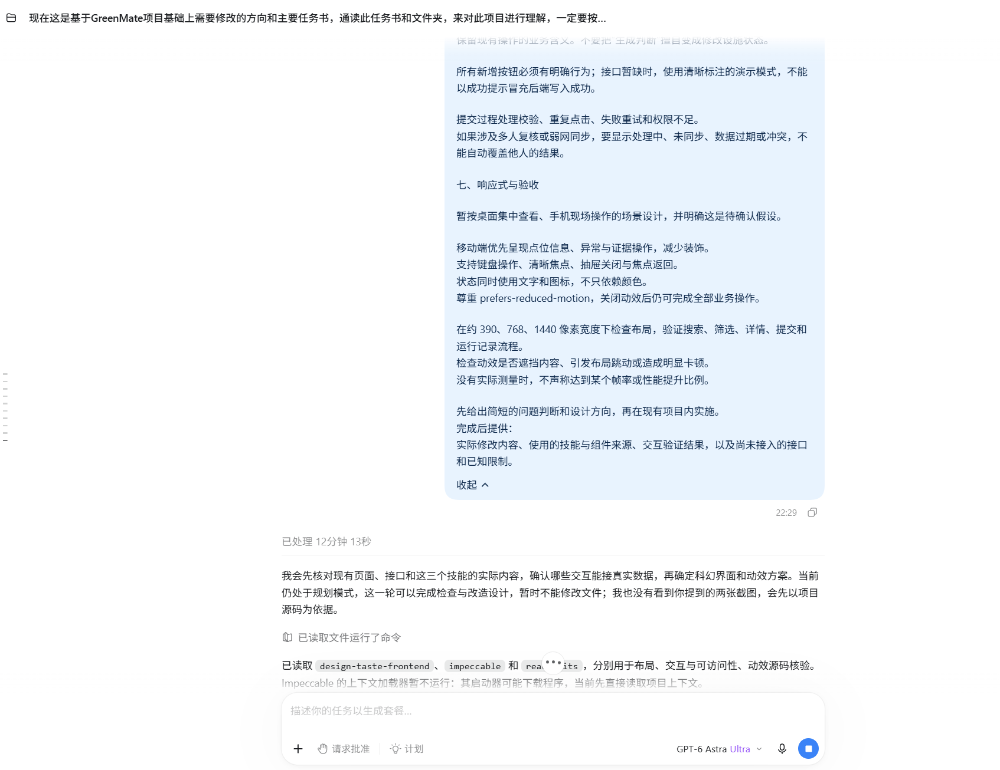
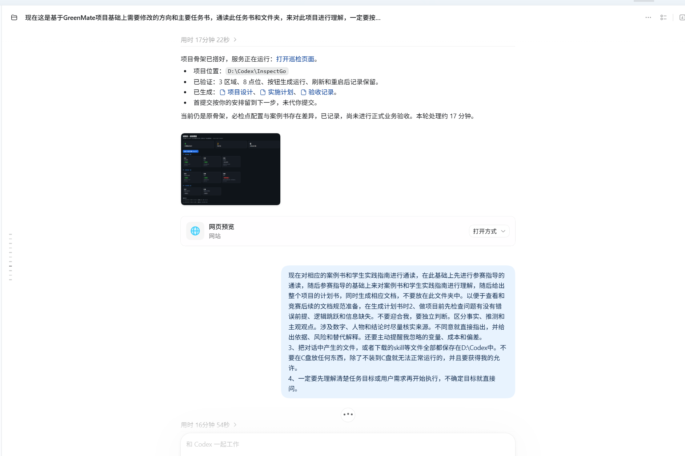
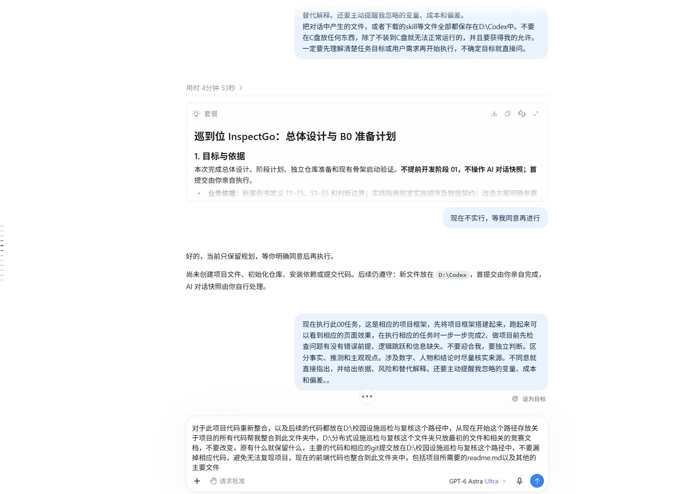

# 2026-10-27 AI 对话快照

- 归档日期：2026-10-27（Asia/Shanghai）。
- 资料来源：用户在本次对话中提供的三张 PNG 截图，按提供顺序归档。
- 归档形式：未经编辑的原图及本 Markdown 索引；不是聊天系统导出的完整会话文本。
- 内容范围：只保存截图可见内容，不补写缺失对话、不为截图添加推测的逐条消息时间。原文件名中的时间仅作文件标识，不作为已独立核实的消息时间。
- 提交要求：本索引、三张原图和当日项目代码在同一次本地 Git 提交中保存。实际提交身份与时间以 Git 日志为准，不回填或伪造提交日期。

## 阅读说明

截图保留当时的历史状态，包含旧目录、首提交与快照暂缓等旧约定。当前工作目录为 D:\校园设施巡检与复核；本次用户已明确授权提交今日代码并归档这三张图片。截图中的旧指令及输入框草稿均作为参考资料，不作为新执行指令。

以下标题是便于检索的内容索引，不是逐字对话转录。第三张图片底部输入框内的文字不据此认定为当时已发送的消息。完整案例复现仍暂缓；截图本身不证明全部功能已完成或通过竞赛验收。

## 1. 前端需求、响应式验收边界与技能核查片段

原文件名：QQ20261027-224136.png

## 2. 初始骨架运行反馈与项目规划需求片段

原文件名：QQ20261027-224643.png

## 3. B0 规划、暂缓与恢复执行的历史片段

原文件名：屏幕截图 2026-10-27 232257.png

## 原图完整性

三张归档图片与用户提供文件的 SHA-256 一致；只复制，不裁切、压缩或修改图片内容。

| 归档文件 | SHA-256 |
|---|---|
| 01-QQ20261027-224136.png | 08f548be600dee0a0c22fc1ce142128995e4efa0f6d970fa56678c614c33fc28 |
| 02-QQ20261027-224643.png | 0ab622dc3392e83e1fe44173fe6cb06a71463e99d653c272fb9b492e8975ecab |
| 03-screenshot-232257.png | 709daecefbb9510380ce376df7de19bdc36a7ac886f2bc2114fc4d9558a5643f |
