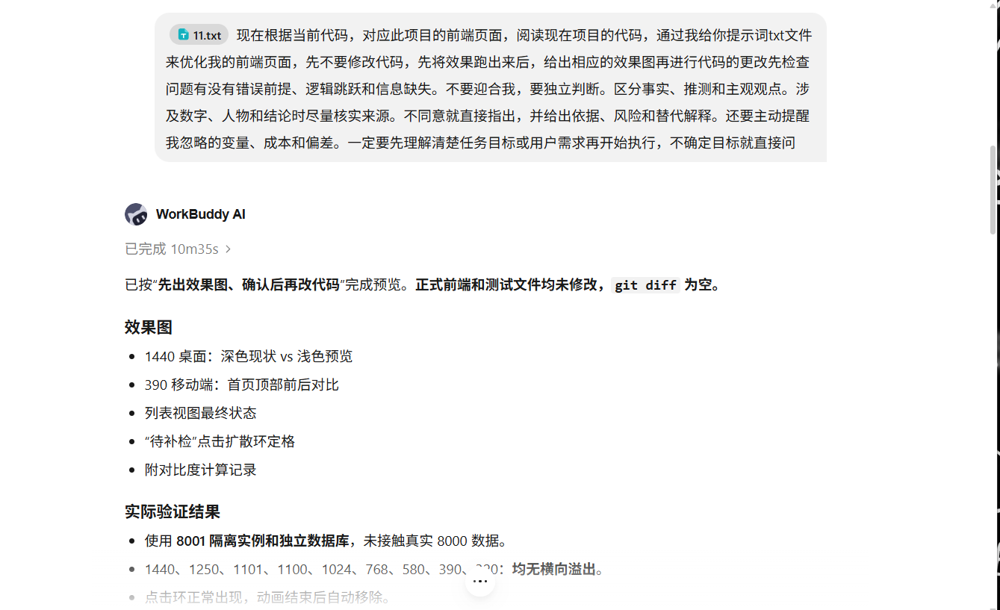

# 2026-10-28 AI 对话快照

- 归档日期：2026-10-28（Asia/Shanghai）。
- 资料来源：用户在本次对话中提供的三张 PNG 截图，按提供顺序归档。
- 归档形式：未经编辑的原图及本 Markdown 索引；属于截图式存档，不是聊天系统导出的完整会话文本。
- 内容范围：仅保留图片可见内容，不补写缺失对话，不推测逐条消息时间。原文件名与截图内时间保留原样，不视为独立核实的消息时间。
- 本索引、三张原图与今日前端代码在同一次本地 Git 提交中保存；提交身份及实际时间以 Git 日志为准，不回填日期。

## 阅读说明

图片中的提示词、旧任务范围和“先不改代码”等表述是历史对话资料，不作为本次新增执行指令。第一张记录的是改造前预览阶段；后两张记录后续前端打磨结果，不应把不同阶段的陈述混为一谈。

第二张页面数字属于截图当时的滚动统计窗口，不能与隔离测试实例的验收截图直接比较。本次归档不修改业务记录或统计数据，也不把截图中的完成反馈扩展为完整案例、真实手机性能或所有浏览器均已验收。

当前代码目录为 `D:\校园设施巡检与复核`。相关实测范围见[日间 Web 前端打磨验收](../evidence/web-polish-2026-10-28/README.md)。以下标题仅供检索，不是逐字对话转录。

## 1. 日间主题改造前的预览与核查交流片段

原文件名：QQ20261028-212615.png

## 2. 前端打磨对话与当时运行页面的并排截图

原文件名：codex-clipboard-0a5d118b-1905-4485-8a37-087742dd4a44.png

## 3. 前端打磨需求、完成反馈与验收范围片段

原文件名：codex-clipboard-d8b70e76-5ead-49c9-929c-b3fac7d69fea.png

## 原图完整性

归档前后逐张核对 SHA-256，内容完全一致；未裁切、压缩或改写图片。

| 归档文件 | SHA-256 |
| --- | --- |
| 01-QQ20261028-212615.png | c00cc2f122046e7ffc9b1f7e3be43a22b195a669f219ea2f1a513af3d54896c9 |
| 02-codex-clipboard-0a5d118b-1905-4485-8a37-087742dd4a44.png | a04f586ae2d93d84872c5c51893394e6ef88fef459dd13ec7a4ada84374ce808 |
| 03-codex-clipboard-d8b70e76-5ead-49c9-929c-b3fac7d69fea.png | 69a01161b80a4772e9fad9c367ea651c61390ce1da2d0ded950e607f434b58a0 |
