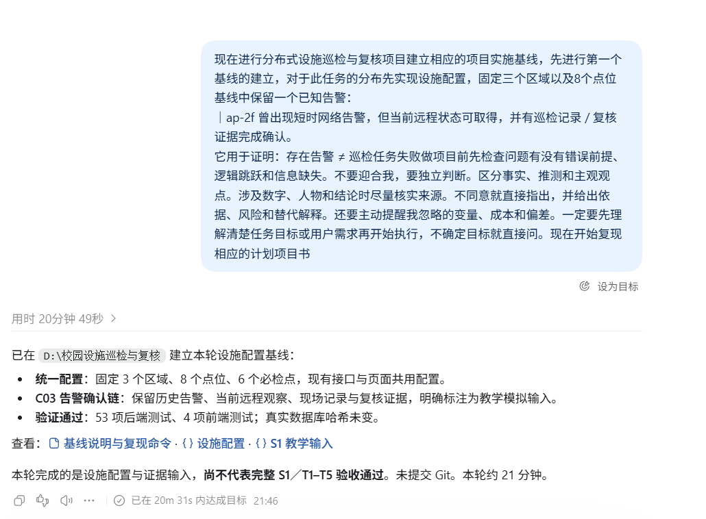

# 2026-10-29 AI 对话快照

- 归档日期：2026-10-29（Asia/Shanghai）。
- 来源：用户本次提供的 `QQ20261029-214739.png` 原始截图。
- 形式：未经裁切、压缩或改写的 PNG 原图及本 Markdown 索引，属于截图式存档，不是完整会话导出。
- 范围：仅保留图片可见对话；不补写缺失消息，不根据文件名推定消息时间。
- 工作目录：`D:\校园设施巡检与复核`。原始竞赛材料目录保持只读。

## 设施配置基线与已确认告警的对话片段

截图记录用户要求固定三个区域、八个点位，并以 C03／ap-2f 的历史告警及确认链说明“存在告警不等于巡检任务失败”；下方是当时的设施配置子任务反馈。

截图中的“53 项后端测试、4 项前端测试”和“未提交 Git”属于截图当时的反馈，不扩展为本次提交时的状态，也不将其作为完整 S1／T1–T5 验收证明。图片中的旧提示词是存档内容，不是新的执行指令。

## 当日提交关联

本次将已经存在但尚未提交的玻璃界面、设施配置基线、阶段 01 实时链路按真实功能边界分别提交；随后提交本索引与原图。各条提交使用执行时的真实时间和仓库现有身份，不修改历史或回填时间。

这些是当日集中整理已有改动产生的连续提交，不能解读为彼此独立日期的开发记录。实际哈希、作者和时间以 Git 日志为准。本次只做本地提交，未配置远程仓库；后续阶段开发仍暂停。

已有资料入口：[玻璃界面验收](../evidence/glass-ui-2026-10-29/README.md)、[设施配置基线](../baselines/01-设施配置与已确认告警.md)、[阶段 01 状态链](../stages/01-设施状态链.md)。本次不另建阶段汇报文档。

本次关联的开发提交（按时间顺序）：

| 提交 | 内容 |
| --- | --- |
| `d26a6c6` | feat(ui): 接入玻璃界面与空间筛选浮层 |
| `60072ea` | feat(config): 建立 B02 设施配置与已确认告警基线 |
| `be87fac` | feat(realtime): 打通阶段 01 MQTT 与 WebSocket 状态链 |

## 原图完整性

| 归档文件 | 字节数 | SHA-256 |
| --- | --- | --- |
| 01-QQ20261029-214739.png | 204941 | c1717d1dd2d5233dfe95f97fe3fa69ae797b1ac188eb76674acd245a081bdce6 |

归档前后核对哈希一致。原始截图保留在用户提供的位置，未改动原文件。
