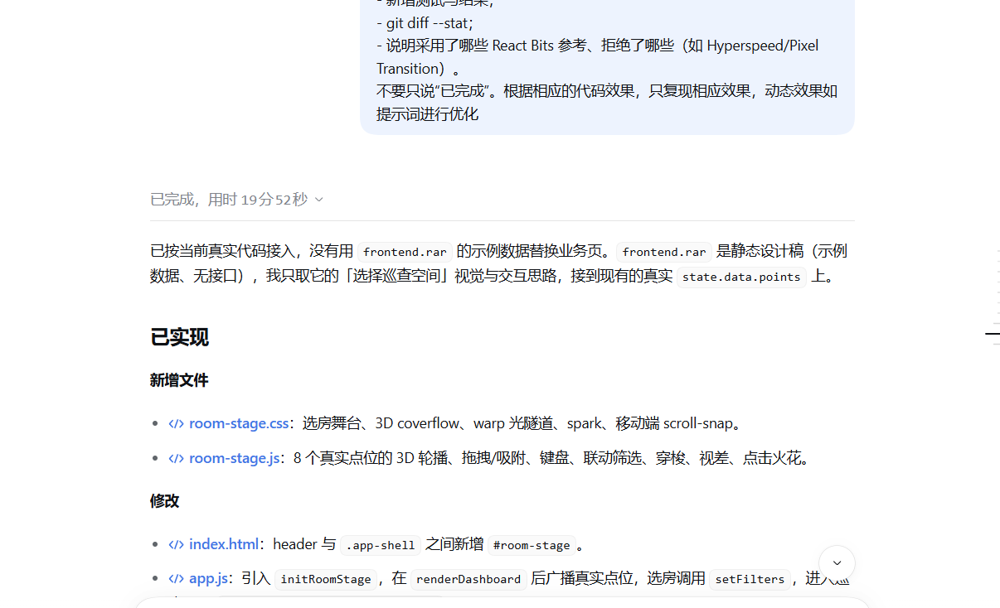

# 2026-10-30 AI 对话快照

- 归档日期：2026-10-30（Asia/Shanghai）。
- 资料来源：用户在对话中提供的一张 PNG 截图（1206×734），内容为 AI 对「3D 选房舞台 + 穿梭 + 视差」完成情况的总结，不是聊天系统导出的完整会话文本。
- 归档形式：未经编辑的原图及本 Markdown 索引；不补写截图之外的消息。
- 内容范围：只记录截图可见的完成总结，以及本日实际对应的 Git 提交；不据此声称完整案例验收或全部功能通过。
- 提交要求：本索引、原图、`02_AI对话快照/01_3D选房与穿梭动效/` 与对应代码提交 `cfb8ff4` 同一天保存；实际提交时间以 Git 日志为准，不回填或伪造日期。

## 阅读说明

截图是 AI 的完成总结，**不包含**用户最初的完整提问、AI 第一版方案、用户纠偏指令或逐条验证输出。上述步骤没有截图或导出记录，不在此补写。  
对应功能提交为 `cfb8ff4`（3D 选房舞台与穿梭视差），提示词文档提交为 `7b2c8ec`。比赛用的案例草稿见 `02_AI对话快照/01_3D选房与穿梭动效/`，其中缺失的 `01/02/04` 步骤已如实标注。

## 1. AI 完成总结截图

原文件名：`image.png`（用户提供）

截图可见内容：已完成说明、新增 `room-stage.css` / `room-stage.js`、修改 `index.html` / `app.js`，并声明 `frontend.rar` 只作视觉与交互参考、未替换真实业务数据。

## 原图完整性

归档图片与用户提供文件一致；只复制，不裁切、压缩或修改图片内容。

| 归档文件 | SHA-256 |
|---|---|
| 01-ai-final-summary.png | 46987ff9f280825638d1a910c13b5b2ffcc49f83728b9a0bf20513c90d513f55 |

## 相关提交

- `cfb8ff4`：`feat(ui): 新增 3D 选房舞台与穿梭视差动效`
- `7b2c8ec`：`docs(prompts): 归档前端复刻与 React Bits 动效提示词`

## 未归档内容

- 用户原始长提示词、AI 第一版实现方案、纠偏截图、完整请求/响应导出：本轮未保留，不能事后补造。
- 仅保存上述完成总结截图；其用途是证明当天确实发生了这次迭代，不替代完整对话记录。
